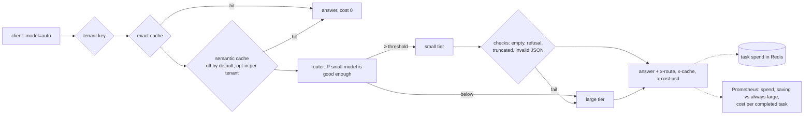

# llm-router-cost-telemetry

[](https://github.com/darshansatpathy/llm-router-cost-telemetry/actions/workflows/ci.yml)
[](https://github.com/darshansatpathy/llm-router-cost-telemetry/actions/workflows/codeql.yml)


An OpenAI-compatible gateway that sends each request to the cheapest model likely to answer it well, caches only what is safe to cache, escalates answers that fail, and reports **cost per completed task**.

Trained and evaluated on real graded traffic: RouteLLM's public dataset of 10,000 prompts, each with a GPT-4 answer, a Mixtral 8x7B answer and a GPT-4 judge's score of the Mixtral answer.

On 2,000 held-out prompts, plus 500 repeats, replayed through the real gateway with Redis 8 ([`docs/replay.md`](docs/replay.md)):

| Policy | Answers a user would get wrong | Cost per completed task | vs always large |
|---|---|---|---|
| Always the large model | 0.0% | $0.00829 | |
| Always the small model | **14.0%** | $0.00146 | −82% (only if every bad answer were caught and redone) |
| **Router** | **3.4%** | $0.00371 | **−55%** |
| **Router + exact cache** | **3.4%** | **$0.00308** | **−63%** |

The router sends 56% of traffic to the small model and keeps 96.5% of the large model's quality on the held-out set (test AUC 0.738, APGR 0.703 against 0.459 for random; [`docs/routing-report.md`](docs/routing-report.md)).

One finding changed the design: on PAWS's adversarial pairs, a sentence embedder cannot tell "flights from Paris to Rome" from "from Rome to Paris". Even at 0.998 cosine similarity, 2% of different-meaning pairs would be served the other's cached answer ([`docs/cache-report.md`](docs/cache-report.md)). So **the semantic cache ships off**; the exact cache is on, and the semantic layer is opt-in per tenant.

## How a request flows



## Using it

```bash
docker compose up -d           # gateway on :8080, Redis 8, Prometheus, Grafana on :3000
```

Point the two tiers in [`gateway.yaml`](gateway.yaml) at any OpenAI-compatible backends, then use the gateway like the OpenAI API:

```python
from openai import OpenAI

client = OpenAI(base_url="http://localhost:8080/v1", api_key="secret")
r = client.chat.completions.with_raw_response.create(
    model="auto",
    temperature=0,
    messages=[{"role": "user", "content": "Summarise this ticket in one line: ..."}],
    extra_headers={"x-task-id": "ticket-4812"},
)
print(r.headers["x-route"], r.headers["x-cache"], r.headers["x-cost-usd"])
```

When the task is done, report it: `POST /v1/tasks/ticket-4812/outcome {"outcome": "success"}`. Its total spend, escalations included, is then counted under that outcome.

| Request | Behaviour |
|---|---|
| `model: "auto"` | the router picks the tier; `x-router-p-small-ok` shows its confidence |
| `model: "small"` / `"large"` | pinned |
| `x-task-id: ...` | spend accumulates against the task |
| `x-cache: no-store` | bypass the cache |

## Retraining for your models

The shipped router is trained on GPT-4 vs Mixtral. For your own pair, grade a sample of your traffic (the small model's answer: good enough or not), put it in the same format, and run `llmrouter train --target-quality 0.95`. `llmrouter replay` then checks the new router end to end through the gateway.

## Design decisions

[ADR 1](docs/adr/0001-router-from-graded-traffic.md) router from graded traffic · [ADR 2](docs/adr/0002-narrow-semantic-cache.md) a narrow semantic cache · [ADR 3](docs/adr/0003-cascade-and-accounting.md) cascade and task accounting

## Data

RouteLLM `gpt4_dataset` (Apache-2.0) and PAWS (Zhang, Baldridge and He, 2019; data from Google LLC) are downloaded by the commands that use them, not redistributed here.

## License

MIT
